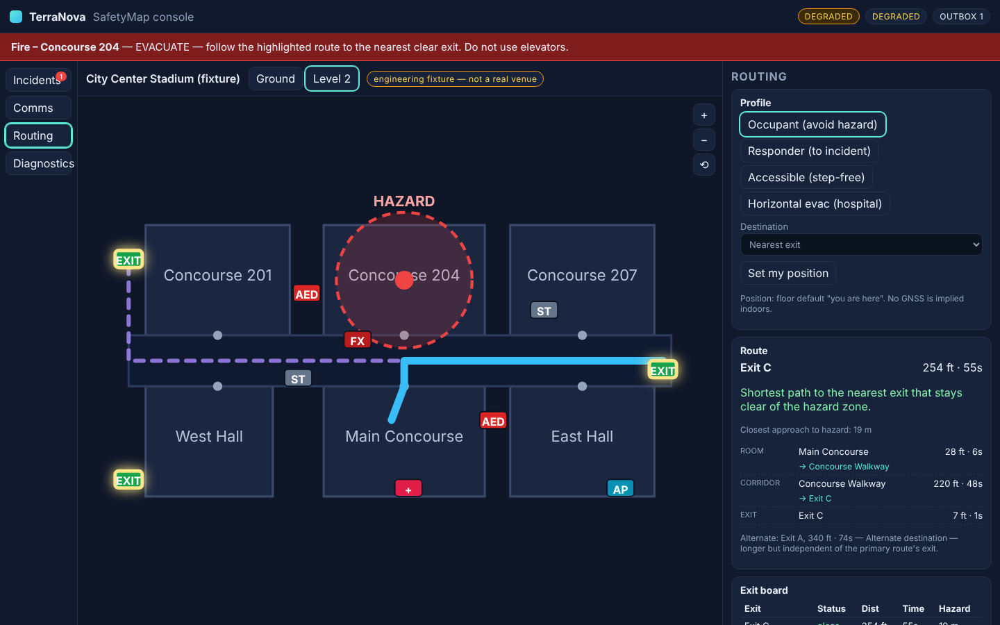

# TerraNova

**TerraNova is the clean, feature-by-feature rebuild of GrahmOS.** Same promise, rebuilt with
pure domain code, a signed data contract, and an automated proof of the offline claim.

> GrahmOS keeps trusted local information, emergency maps, routing, and operational workflows
> available when connectivity is unavailable, intermittent, or controlled by a provider the operator
> cannot depend on.

The reference implementation is [`Greenmamba29/Grahmos_terranova`](https://github.com/Greenmamba29/Grahmos_terranova).
Each GrahmOS feature is re-implemented here in order, with its claim boundary stated and a gate
that enforces it. See [docs/FEATURE_MAP.md](docs/FEATURE_MAP.md) for the sequence and status.

## What is rebuilt so far

Features 1–11 of the [feature map](docs/FEATURE_MAP.md): the Tier-0 life-safety path, trust
hardening, importers, local search, the georeferenced site map, positioning, the Tier-1 facility
relay, the resilience audit and evidence report, localisation, and CoT export. The remaining item is
the Tier-2 facility edge (pack registry and store-and-forward across restarts for packs).

### Feature 1: offline-first resilience, emergency communications, SafetyMap

| Capability                                                                                                                                     | Where                                         | Proof                           |
| ---------------------------------------------------------------------------------------------------------------------------------------------- | --------------------------------------------- | ------------------------------- |
| Fuzzy connectivity (full / degraded / local) with hysteresis; `navigator.onLine` trusted only when false                                       | `packages/core/src/connectivity`              | unit tests                      |
| Offline readiness contract: READY / DEGRADED / ERROR with reasons, never mock data                                                             | `packages/core/src/readiness`                 | unit tests, console Diagnostics |
| Event-sourced incidents: declare, update, contain, resolve, relocate                                                                           | `packages/core/src/comms`                     | unit tests                      |
| Emergency alerts with per-device acknowledgements and check-ins                                                                                | `packages/core/src/comms`, console Comms pane | unit tests, drill               |
| Hash-chained local event log, verifiable offline                                                                                               | `packages/core/src/comms/auditChain.ts`       | unit tests, drill               |
| Durable outbox: ordered flush, backoff, halts on retry, drops rejected, inspectable                                                            | `packages/core/src/comms/outbox.ts`           | unit tests                      |
| Floor contract (IMDF-style GeoJSON in venue metres) + validator                                                                                | `packages/core/src/safetymap/floor.ts`        | unit tests, pack gate           |
| Graph extraction with mis-georeference detection; hazard-aware A*; nearest-exit / nearest-asset                                                | `graph.ts`, `astar.ts`, `planner.ts`          | unit tests                      |
| Routing profiles: occupant, responder, accessible (step-free), horizontal evacuation (smoke compartments)                                      | `planner.ts`, `compartments.ts`               | unit tests                      |
| Exit board (clear → hazard → unreachable, then nearest) and building-derived egress legs                                                       | `exitBoard.ts`, `egressLegs.ts`               | unit tests                      |
| Incident playbooks (fire, medical, lockdown, outage, severe weather, hazmat) with auto-routing and role cards                                  | `playbooks.ts`                                | console banner                  |
| Venue pack v3: SHA-256 over every file, Ed25519 signature over the canonical manifest, pinned keys, anti-rollback, deterministic build         | `packages/core/src/pack`, `packages/cli`      | unit tests, `npm run gates`     |
| Console PWA: SVG SafetyMap in metre-space, level switcher, incident mode, comms, routing, diagnostics, evidence export, pane fault containment | `apps/console`                                | offline drill                   |

### The offline drill

`scripts/e2e-offline.mjs` provisions a device once online, declares a fire, broadcasts and
acknowledges an alert, then **cuts the network and hard-reloads**. The console must come back with
the map, the incident, the hazard-aware route, the exit board and an intact event chain, with no
origin reachable. CI runs it on every push.

```
• online: console booted and rendered the verified fixture pack
• service worker controls the page; readiness: DEGRADED
• incident declared: banner, hazard zone and hazard-aware route rendered
• alert broadcast and acknowledged locally
• outbox holds 3 durable writes
• OFFLINE reload: map, incident and route restored from the device (connectivity band: local)
• site map rendered offline from the signed anchor (MapLibre canvas present)
• exit board offline: 3 exits ranked
• event chain verified offline
OFFLINE DRILL PASSED
```

(`DEGRADED`, not `READY`, in headless Chromium: persistent storage is declined there and the
console says so instead of hiding it.)



## Layout

```
packages/core     pure TypeScript domain (no DOM, no IndexedDB, no fetch) — tested in Node
packages/cli      `terranova` — build / sign / verify / inspect packs, floor gates, DXF import, audit, keygen
packages/relay    `terranova-relay` — LAN store-and-forward relay for signed incident envelopes
apps/console      Vite + React PWA; Dexie storage adapters; service worker; the SafetyMap console
scripts/gates.mjs release gates: offline, secrets, fixtures, packs, determinism
scripts/e2e-offline.mjs  the installed-device offline drill
scripts/e2e-relay.mjs    the two-device relay drill (V2a acceptance)
docs/             ADRs, feature map, claim boundaries
```

## Quick start

```bash
npm ci
npm run ci                 # typecheck · lint · tests · gates · build
npm run dev -w @terranova/console
npm run preview -w @terranova/console   # production preview — the path that proves offline
```

Pack tooling:

```bash
npm run terranova -- pack fixture out/city.zip
npm run terranova -- pack verify out/city.zip
npm run terranova -- gate floors path/to/floor.geojson
npm run terranova -- keygen          # prints a SECRET seed + public key
```

## Claim boundaries

- **Offline after provisioning.** One online visit installs the shell and verifies a pack into
  IndexedDB. An unprovisioned browser cannot load an uncached app with its origin dead, and the
  console never claims otherwise.
- **Fixture packs are fixtures.** City Center Stadium and Harbor General are engineering fixtures
  signed with a public test seed. The console labels them; the gates refuse a bundled pack that
  claims more.
- **Signed ≠ validated.** A verified signature proves who built the pack, not that a fire marshal
  walked the floor. `provenance.validation` carries that claim separately.
- **Local outbox; relay when you run one.** Writes are durable and inspectable on the device.
  `npm run relay` starts a LAN relay; enter its address under Diagnostics and devices exchange
  signed envelopes with no WAN. Device keys are pinned on first sight and are self-attested until
  facility enrollment (Tier 2).

## License

Apache-2.0.
